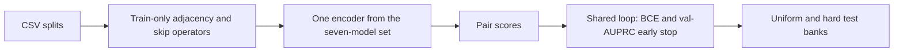

# Enhanced-SkipGNN

[](https://www.python.org/downloads/)
[](https://pytorch.org/)
[](LICENSE)
[](https://github.com/aryonmt/Enhanced-SkipGNN/stargazers)
[](https://github.com/aryonmt/Enhanced-SkipGNN/network/members)

A leak-free SkipGNN benchmark with seven predictors on the same molecular graphs. Code: [aryonmt/Enhanced-SkipGNN](https://github.com/aryonmt/Enhanced-SkipGNN).

## Overview

[SkipGNN](https://github.com/kexinhuang12345/SkipGNN) (Huang et al., *Scientific Reports*, 2020) predicts molecular interactions by passing messages on the original interaction graph and on a skip graph of second-order similarity. This repository reimplements that setup so validation and test edges never enter the training adjacency, then trains and compares a **set of encoders** under one protocol.

The benchmark treats these seven predictors as peers:

| CLI key | Model | What it changes |
| --- | --- | --- |
| `gcn` | `StandardGCN` | Messages on the original graph only |
| `skipgnn` | `SkipGNNBaseline` | Huang et al.: binary 2-hop skip, additive fusion, concat decoder |
| `ams` | `AMSSkipGNN` | Weighted resource-allocation skip, gated fusion, four-way decoder |
| `heuristic` | resource allocation | Non-neural scores on the train graph |
| `gat` | `SkipGATv2` | Sparse GATv2 on the original and skip graphs |
| `3hop` | `ThreeHopSkipGNN` | 1-hop, 2-hop, and 3-hop streams with path attention |
| `contrastive` | `ContrastiveSkipGNN` | Dual-view SkipGNN plus batch InfoNCE while training |

Graphs are the public SkipGNN fold-1 splits: drug–target (**DTI**), drug–drug (**DDI**), protein–protein (**PPI**), and gene–disease (**GDI**). The pip distribution name is `ams-skipgnn`; Python modules import from `src`.

Convolutions are the custom PyTorch `SparseGraphConvolution` in `src/models/layers.py` (`XW`, then a sparse `A @ support`). Hardware and install details for this checkout live in the quickstart below and in `environment.yml`.

## Pipeline



The factory is `src.models.build_model`. `ams` uses a gate and the four-way decoder `[h_u; h_v; h_u ⊙ h_v; |h_u − h_v|]`. `gat`, `3hop`, and `contrastive` use their own fusion. `gcn` has no skip graph. `heuristic` skips the neural decoder.

## Key features

- **One protocol for every model.** Shared splits, seeds `42` / `123` / `7`, Adam settings, early stopping on validation AUPRC, and dual test banks ([docs/architecture.md](docs/architecture.md), [docs/models.md](docs/models.md)).
- **Leak-free graphs.** `src.data.loader` builds adjacency and skip operators from train positives only. Validation and test edges never enter `A` or the skip graphs.
- **Skip-graph family.** Binary 2-hop SkipGNN, weighted resource-allocation skip (`ams` and several others), sparse GATv2 (`gat`, vectorized under a memory cap, otherwise chunked), path attention over 1/2/3-hop walks (`3hop`), and a contrastive dual view (`contrastive`).
- **AMS ablation, scoped to that encoder.** `scripts/run_ablation.py` walks `0_skipgnn` → `1_weighted` → `2_gated` → `3_full` for `AMSSkipGNN` only. That ladder is an experiment on `ams`, separate from the seven-model benchmark.
- **Resource-allocation heuristic.** One-hop RA on homogeneous graphs; a 3-walk RA on bipartite graphs (DTI, GDI), where one-hop common neighbors are empty.
- **Dual test banks and a frozen threshold.** Uniform test is the official test CSV. Hard test pairs official test positives with degree-biased negatives. F1 threshold `τ*` is fit on validation only. Benchmark rows merge on `(dataset, model, seed)`.

## Benchmark

Means over seeds **42, 123, and 7**, rounded to 3 decimals from [`results/model_comparison.csv`](results/model_comparison.csv). Uniform AUPRC is the official test split. Hard AUPRC uses degree-biased negatives and is the metric that separates models. No latency was logged.

| Model | DTI uniform | DTI hard | DDI uniform | DDI hard | PPI uniform | PPI hard | GDI uniform | GDI hard |
| --- | ---: | ---: | ---: | ---: | ---: | ---: | ---: | ---: |
| GCN | 0.917 | 0.731 | 0.907 | 0.658 | 0.919 | 0.609 | 0.934 | 0.749 |
| SkipGNN | 0.929 | 0.695 | 0.929 | 0.724 | 0.928 | 0.622 | 0.934 | 0.720 |
| AMS-SkipGNN | 0.918 | 0.798 | 0.980 | **0.912** | 0.931 | 0.674 | 0.951 | 0.829 |
| SkipGATv2 | 0.912 | **0.804** | 0.967 | 0.900 | 0.895 | **0.778** | 0.934 | 0.837 |

No encoder wins every graph. On hard AUPRC, `ams` leads **DDI** (0.912). `gat` leads **PPI** (0.778) and is slightly ahead on **DTI** (0.804 vs 0.798 for `ams`). On **GDI**, the resource-allocation heuristic is 0.842, slightly ahead of `ams` (0.829).

Hard AUPRC for the other three keys, same three-seed mean: heuristic / 3-hop / contrastive — DTI 0.776 / 0.803 / 0.800; DDI 0.672 / 0.895 / 0.905; PPI 0.578 / 0.688 / 0.657; GDI 0.842 / 0.832 / 0.833.

### Evaluation rules

- Train positives are the only edges in adjacency `A`. Validation and test edges do not leak into the graph.
- Uniform test is the official test CSV. Hard test is official test positives plus degree-biased negatives that respect the bipartite cut on DTI and GDI.
- `τ*` is fit on validation F1 only, then frozen for both test banks.
- The table reports threshold-free AUPRC (`uniform_auprc`, `hard_auprc`). F1 uses the frozen validation threshold `τ*`.
- `--quick` is a 2-epoch smoke test. It writes `results/temp/` and must not be reported.

## Quickstart

Hardware and install details live in this section and in [`environment.yml`](environment.yml). Python 3.10+ and PyTorch 2.1+. A GPU is not required for install or `pytest`. Full GPU training is the Kaggle T4 protocol in [docs/kaggle.md](docs/kaggle.md).

```bash
python -m venv .venv
```

Windows (PowerShell):

```powershell
.venv\Scripts\activate
```

Linux and macOS:

```bash
source .venv/bin/activate
```

Then:

```bash
pip install -e ".[dev]"
python scripts/fetch_data.py
pytest -q
python scripts/make_figures.py --skip-tsne
```

`pip install -e ".[dev]"` installs the `ams-skipgnn` distribution; that name is the package on PyPI-style metadata, while the repository is Enhanced-SkipGNN. Python modules import from `src`. Conda: `conda env create -f environment.yml`. A GPU install uses the PyTorch wheel whose CUDA build matches the driver ([pytorch.org](https://pytorch.org/get-started/locally/)); this repo does not use PyTorch Geometric. `fetch_data.py` sparse-clones [kexinhuang12345/SkipGNN](https://github.com/kexinhuang12345/SkipGNN) and copies `data/{DDI,PPI,DTI,GDI}/fold1/` into `data/raw/{DDI,PPI,DTI,GDI}/`. Those fold-1 paths are the official splits.

`make_figures.py --skip-tsne` rebuilds the PNGs from cached `results/` and rewrites `results/model_comparison.csv`. t-SNE PNGs need gitignored `embeddings_*.npz`.

Paper training uses `configs/default.yaml` plus `configs/<dataset>.yaml`. Omitting `--seeds` uses `seeds_stage1` from that merge, which is `42 123 7`. DTI, DDI, and PPI: 30 epochs, patience 8. GDI: 20 epochs, patience 6, batch 256. Adam `1e-3`, dropout 0.5, hidden 64.

```bash
python scripts/run_benchmark.py --dataset DTI --models gcn skipgnn ams heuristic gat 3hop contrastive --seeds 42 123 7
```

Rows merge into `results/<DATASET>/benchmark.csv` by `(dataset, model, seed)`. CPU smoke (not a paper number):

```bash
python scripts/run_benchmark.py --dataset DDI --quick --device cpu
```

The seven CLI keys are listed in the overview. Further reading: [docs/README.md](docs/README.md).

## Repository layout

```
configs/                 default.yaml plus per-dataset overlays (dti, ddi, ppi, gdi)
data/raw/{DTI,DDI,PPI,GDI}/   fold-1 train, val, test, and entity lists
docs/                    architecture, models, sampling, protocol, results, Kaggle
figures/                 300 DPI PNGs regenerated from results/
notebooks/               Kaggle runner; executed/ holds finished stage logs
results/                 benchmark.csv, summary.json, PR arrays, ablation, robustness
scripts/                 fetch_data, run_benchmark, ablation, robustness, figures, Kaggle zip import
src/data/                constants, leak-free loader, skip-graph operators, negative samplers
src/models/              shared sparse layers plus the seven predictors and factory
src/training/            seed, BCE loop, val-AUPRC early stop, dual-bank eval
src/eval/                τ*, AUROC/AUPRC/F1, figure generation
tests/                   CPU unit tests
environment.yml          Conda env (Python pin and pip install)
pyproject.toml           package metadata; distribution name ams-skipgnn
CITATION.cff             software citation for Enhanced-SkipGNN; preferred paper is Huang et al.
```

On-disk dataset names are `DTI`, `DDI`, `PPI`, and `GDI`.

## Citation

SkipGNN (upstream paper and fold-1 splits). Code: [https://github.com/kexinhuang12345/SkipGNN](https://github.com/kexinhuang12345/SkipGNN).

```bibtex
@article{huang2020skipgnn,
  title   = {SkipGNN: predicting molecular interactions with skip-graph networks},
  author  = {Huang, Kexin and Xiao, Cao and Glass, Lucas M. and Zitnik, Marinka and Sun, Jimeng},
  journal = {Scientific Reports},
  volume  = {10},
  number  = {1},
  pages   = {21092},
  year    = {2020},
  doi     = {10.1038/s41598-020-77766-9}
}
```

This repository:

```bibtex
@software{aryon2026enhancedskipgnn,
  title   = {Enhanced-SkipGNN},
  author  = {aryonmt},
  year    = {2026},
  version = {0.1.0},
  url     = {https://github.com/aryonmt/Enhanced-SkipGNN},
  license = {MIT}
}
```

Machine-readable metadata: [`CITATION.cff`](CITATION.cff).
